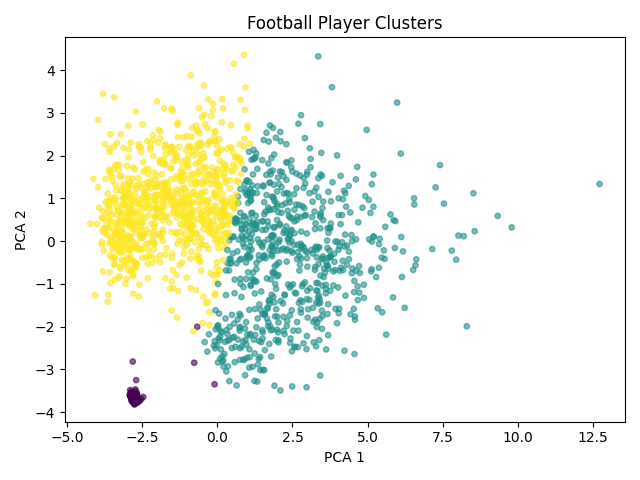
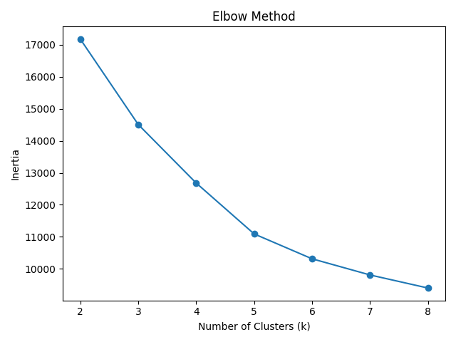
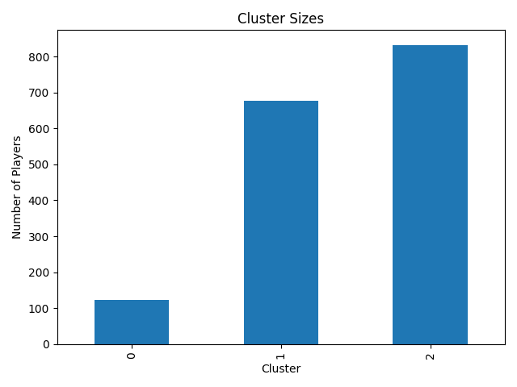

# Football Player Playing-Style Clustering

Groups football players by statistical playing style rather than using their position labels.

---

## Problem Statement & Overview

This unsupervised learning project uses **StandardScaler** and **K-Means** to discover similar records without training labels. The workflow covers preprocessing, training, evaluation, visualization, and prediction for a new sample.

## Pipeline Architecture

```text
Raw CSV -> preprocessing.py -> cleaned CSV
        -> train.py -> scaler + KMeans + feature columns
        -> evaluate.py -> metrics, profiles and plots
        -> predict.py -> sample cluster assignment
```

## Dataset & Feature Description

- **Raw dataset:** `dataset/2022-2023 Football Player Stats.csv` (2,689 records in the supplied file).
- **Clean dataset:** `dataset/clean_football_players.csv` (1,632 records in the supplied file).
- **Clustering features (15):** `Shots`, `SoT`, `Assists`, `PasAss`, `PasProg`, `SCA`, `Tkl`, `Int`, `Blocks`, `Clr`, `ToAtt`, `ToSuc`, `CarProg`, `RecProg`, `AerWon`.

Reads semicolon-separated, Latin-1 data, removes duplicates, keeps players with at least 450 minutes, fills missing Nation values with Unknown, and imputes missing numeric features with their medians. Player, Nation, Pos, Squad, Comp, Age and Min are metadata, excluded from training.

## Model & Clustering Approach

- **Algorithm:** `KMeans(n_clusters=3, random_state=42, n_init=20)`.
- **Scaling:** `StandardScaler` fitted on the clustering features.
- **Saved objects:** `models/kmeans.pkl`, `models/scaler.pkl`, `models/feature_columns.pkl`.
- **Inference:** `predict.py` aligns its example input to the saved feature order, scales it, and assigns a cluster.

The scripts use a fixed cluster count. Evaluation plots inertia for candidate values 2 through 8; it does not automatically select or retrain the final model with a different value.

## Evaluation & Diagnostics

`evaluate.py` prints inertia, silhouette score, Davies-Bouldin score, cluster sizes, profiles, and a single-row sanity check. Higher silhouette and lower Davies-Bouldin scores generally indicate better separation; inertia is useful for comparing cluster counts on the same scaled dataset.

### Saved Cluster Profiles

These means come from the supplied `outputs/cluster_profiles.csv`; rerunning training can change the results and cluster IDs.

| Cluster | Shots | SoT | Assists | PasAss | PasProg | SCA | Tkl | Int | Blocks | Clr | ToAtt | ToSuc | CarProg | RecProg | AerWon |
| --- | --- | --- | --- | --- | --- | --- | --- | --- | --- | --- | --- | --- | --- | --- | --- |
| 0 | 0.05 | 0.01 | 0.0 | 0.04 | 0.07 | 0.19 | 0.03 | 0.04 | 0.02 | 0.4 | 0.03 | 0.02 | 0.02 | 0.08 | 0.19 |
| 1 | 2.02 | 0.74 | 0.16 | 1.4 | 3.64 | 3.12 | 1.39 | 0.54 | 0.91 | 0.74 | 2.67 | 1.05 | 2.43 | 6.36 | 1.08 |
| 2 | 0.64 | 0.16 | 0.04 | 0.54 | 3.86 | 1.41 | 1.94 | 1.22 | 1.26 | 2.55 | 0.88 | 0.37 | 1.1 | 1.79 | 1.53 |

The saved position distribution shows cluster 0 is predominantly goalkeepers, cluster 1 contains more attacking profiles, and cluster 2 contains more defensive profiles. These are descriptive interpretations rather than target labels.

### Visual Diagnostics







## How to Run

Run these PowerShell commands from this project folder. The shared environment lives in the parent `Clustering` directory.

```powershell
# Create the environment once if it does not exist
python -m venv ../.venv
../.venv/Scripts/python.exe -m pip install -r requirements.txt

# Model directories are ignored by Git, so create them after cloning
New-Item -ItemType Directory -Force models, outputs | Out-Null
../.venv/Scripts/python.exe preprocessing.py
../.venv/Scripts/python.exe train.py
../.venv/Scripts/python.exe evaluate.py
../.venv/Scripts/python.exe predict.py
```

On macOS/Linux, use `../.venv/bin/python` and `mkdir -p models outputs`. Run scripts from this project directory because their paths are relative to the current working directory. Edit the example in `predict.py` to assign your own sample; cluster IDs are arbitrary identifiers.

## Directory Structure

```text
football_player_clustering/
|-- dataset/              # Raw and cleaned CSV files
|-- models/               # Generated model, scaler and feature order (ignored)
|-- outputs/              # Cluster profiles and diagnostic plots
|-- preprocessing.py
|-- train.py
|-- evaluate.py
|-- predict.py
|-- requirements.txt
`-- README.md
```

[Back to Clustering](../README.md) | [Repository overview](../../README.md)
