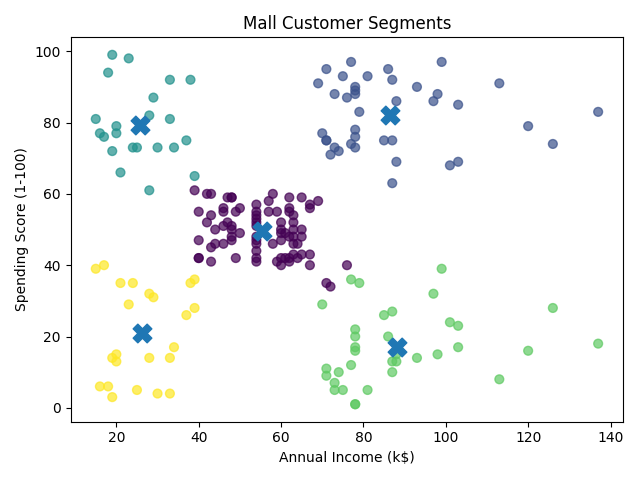
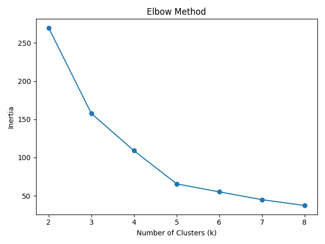
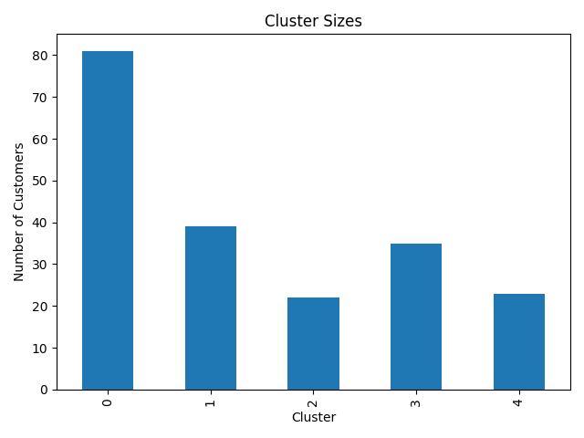

# Mall Customer Segmentation

Groups customers by income and spending behavior to support customer profiling.

---

## Problem Statement & Overview

This unsupervised learning project uses **StandardScaler** and **K-Means** to discover similar records without training labels. The workflow covers preprocessing, training, evaluation, visualization, and prediction for a new sample.

## Pipeline Architecture

```text
Raw CSV -> preprocessing.py -> cleaned CSV
        -> train.py -> scaler + KMeans + feature columns
        -> evaluate.py -> metrics, profiles and plots
        -> predict.py -> sample cluster assignment
```

## Dataset & Feature Description

- **Raw dataset:** `dataset/Mall_Customers.csv` (200 records in the supplied file).
- **Clean dataset:** `dataset/clean_mall_customers.csv` (200 records in the supplied file).
- **Clustering features (2):** `Annual Income (k$)`, `Spending Score (1-100)`.

Removes duplicate rows and drops CustomerID. Age and Gender are retained for interpretation but excluded from training.

## Model & Clustering Approach

- **Algorithm:** `KMeans(n_clusters=5, random_state=42, n_init=10)`.
- **Scaling:** `StandardScaler` fitted on the clustering features.
- **Saved objects:** `models/kmeans.pkl`, `models/scaler.pkl`, `models/feature_columns.pkl`.
- **Inference:** `predict.py` aligns its example input to the saved feature order, scales it, and assigns a cluster.

The scripts use a fixed cluster count. Evaluation plots inertia for candidate values 2 through 8; it does not automatically select or retrain the final model with a different value.

## Evaluation & Diagnostics

`evaluate.py` prints inertia, silhouette score, Davies-Bouldin score, cluster sizes, profiles, and a single-row sanity check. Higher silhouette and lower Davies-Bouldin scores generally indicate better separation; inertia is useful for comparing cluster counts on the same scaled dataset.

### Saved Cluster Profiles

These means come from the supplied `outputs/cluster_profiles.csv`; rerunning training can change the results and cluster IDs.

| Cluster | Age | Annual Income (k$) | Spending Score (1-100) |
| --- | --- | --- | --- |
| 0 | 42.72 | 55.3 | 49.52 |
| 1 | 32.69 | 86.54 | 82.13 |
| 2 | 25.27 | 25.73 | 79.36 |
| 3 | 41.11 | 88.2 | 17.11 |
| 4 | 45.22 | 26.3 | 20.91 |

The saved profiles describe middle-income moderate spenders, high-income high spenders, low-income high spenders, high-income low spenders, and low-income low spenders (clusters 0 through 4).

### Visual Diagnostics







## How to Run

Run these PowerShell commands from this project folder. The shared environment lives in the parent `Clustering` directory.

```powershell
# Create the environment once if it does not exist
python -m venv ../.venv
../.venv/Scripts/python.exe -m pip install -r requirements.txt

# Model directories are ignored by Git, so create them after cloning
New-Item -ItemType Directory -Force models, outputs | Out-Null
../.venv/Scripts/python.exe preprocessing.py
../.venv/Scripts/python.exe train.py
../.venv/Scripts/python.exe evaluate.py
../.venv/Scripts/python.exe predict.py
```

On macOS/Linux, use `../.venv/bin/python` and `mkdir -p models outputs`. Run scripts from this project directory because their paths are relative to the current working directory. Edit the example in `predict.py` to assign your own sample; cluster IDs are arbitrary identifiers.

## Directory Structure

```text
mall_customer_segmentation/
|-- dataset/              # Raw and cleaned CSV files
|-- models/               # Generated model, scaler and feature order (ignored)
|-- outputs/              # Cluster profiles and diagnostic plots
|-- preprocessing.py
|-- train.py
|-- evaluate.py
|-- predict.py
|-- requirements.txt
`-- README.md
```

[Back to Clustering](../README.md) | [Repository overview](../../README.md)
