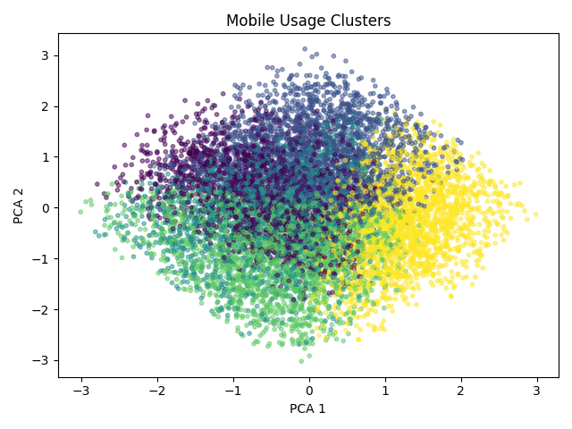
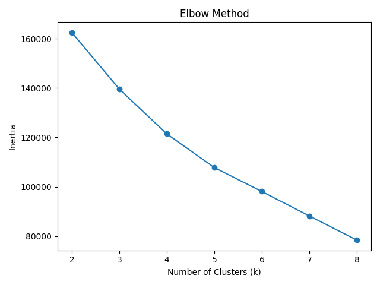
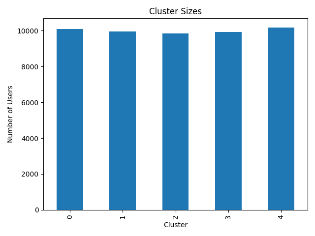

# Mobile Usage Behavior Clustering

Discovers groups of smartphone users from phone time, social media use, app counts, and weekend screen time.

---

## Problem Statement & Overview

This unsupervised learning project uses **StandardScaler** and **K-Means** to discover similar records without training labels. The workflow covers preprocessing, training, evaluation, visualization, and prediction for a new sample.

## Pipeline Architecture

```text
Raw CSV -> preprocessing.py -> cleaned CSV
        -> train.py -> scaler + KMeans + feature columns
        -> evaluate.py -> metrics, profiles and plots
        -> predict.py -> sample cluster assignment
```

## Dataset & Feature Description

- **Raw dataset:** `dataset/Smartphone_Usage_Productivity_Dataset_50000.csv` (50,000 records in the supplied file).
- **Clean dataset:** `dataset/clean_mobile_usage.csv` (50,000 records in the supplied file).
- **Clustering features (4):** `Daily_Phone_Hours`, `Social_Media_Hours`, `App_Usage_Count`, `Weekend_Screen_Time_Hours`.

Removes duplicate rows and retains the remaining columns. Age, Work_Productivity_Score, Sleep_Hours, Stress_Level, Caffeine_Intake_Cups and Device_Type are used only for interpretation, not training. Missing values are reported but are not imputed.

## Model & Clustering Approach

- **Algorithm:** `KMeans(n_clusters=5, random_state=42, n_init=10)`.
- **Scaling:** `StandardScaler` fitted on the clustering features.
- **Saved objects:** `models/kmeans.pkl`, `models/scaler.pkl`, `models/feature_columns.pkl`.
- **Inference:** `predict.py` aligns its example input to the saved feature order, scales it, and assigns a cluster.

The scripts use a fixed cluster count. Evaluation plots inertia for candidate values 2 through 8; it does not automatically select or retrain the final model with a different value.

## Evaluation & Diagnostics

`evaluate.py` prints inertia, silhouette score, Davies-Bouldin score, cluster sizes, profiles, and a single-row sanity check. Higher silhouette and lower Davies-Bouldin scores generally indicate better separation; inertia is useful for comparing cluster counts on the same scaled dataset.

Silhouette is computed on a reproducible sample of up to 10,000 rows; Davies-Bouldin uses all rows. The PCA plot uses that sample.

### Saved Cluster Profiles

These means come from the supplied `outputs/cluster_profiles.csv`; rerunning training can change the results and cluster IDs.

| Cluster | Daily_Phone_Hours | Social_Media_Hours | App_Usage_Count | Weekend_Screen_Time_Hours |
| --- | --- | --- | --- | --- |
| 0 | 3.48 | 6.25 | 36.84 | 8.35 |
| 1 | 9.42 | 4.88 | 40.27 | 10.88 |
| 2 | 6.32 | 2.61 | 45.64 | 5.33 |
| 3 | 4.98 | 2.44 | 20.88 | 10.27 |
| 4 | 8.34 | 5.09 | 18.94 | 5.22 |

Profiles summarize usage patterns. Lifestyle associations are descriptive and do not establish that phone usage causes changes in sleep, stress, or productivity.

### Visual Diagnostics







## How to Run

Run these PowerShell commands from this project folder. The shared environment lives in the parent `Clustering` directory.

```powershell
# Create the environment once if it does not exist
python -m venv ../.venv
../.venv/Scripts/python.exe -m pip install -r requirements.txt

# Model directories are ignored by Git, so create them after cloning
New-Item -ItemType Directory -Force models, outputs | Out-Null
../.venv/Scripts/python.exe preprocessing.py
../.venv/Scripts/python.exe train.py
../.venv/Scripts/python.exe evaluate.py
../.venv/Scripts/python.exe predict.py
```

On macOS/Linux, use `../.venv/bin/python` and `mkdir -p models outputs`. Run scripts from this project directory because their paths are relative to the current working directory. Edit the example in `predict.py` to assign your own sample; cluster IDs are arbitrary identifiers.

## Directory Structure

```text
mobile_usage_clustering/
|-- dataset/              # Raw and cleaned CSV files
|-- models/               # Generated model, scaler and feature order (ignored)
|-- outputs/              # Cluster profiles and diagnostic plots
|-- preprocessing.py
|-- train.py
|-- evaluate.py
|-- predict.py
|-- requirements.txt
`-- README.md
```

[Back to Clustering](../README.md) | [Repository overview](../../README.md)
